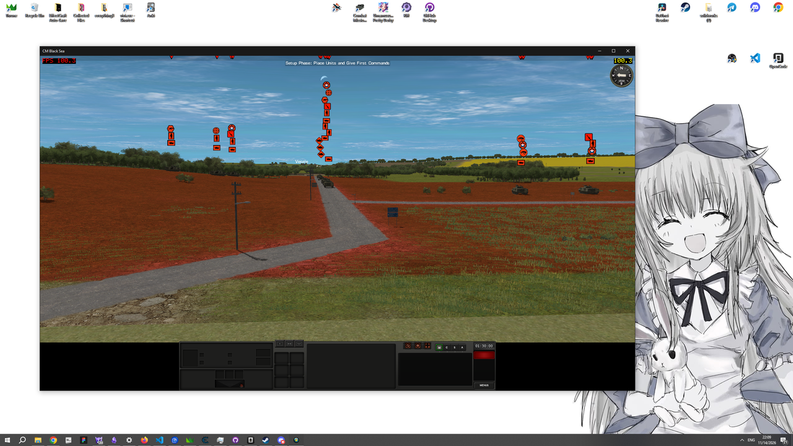

# Combat Mission Coke

**Experimental DLL proxy for Combat Mission games**

Resizable window, borderless `F11` fullscreen, live UI re-layout, alt-tab without a black flash, FPS counter, process tuning, native mod loader.

[Install](docs/user/INSTALL.md) · [Configure](docs/ai/CONFIG.md) · [Features](#features) · [Profiles](#profiles) · [Submods](#submods) · [Build](docs/user/DEVELOPING.md#build-from-source) · [Findings](docs/ai/FINDINGS.md) · [Porting](docs/ai/PORTING.md) · [Changelog](docs/meta/CHANGELOG.md)

> [!WARNING]
> This project is work in progress. Downloading it right now will probably not work on your install: every build needs a matching profile. If you have access to agents, read [DEVELOPING.md](docs/user/DEVELOPING.md) to create a profile for your install. Please submit the resulting profile.

## Features

|  | State |
|---|---|
| Framed, resizable window (`window_scale`) | Working |
| Borderless fullscreen, `F11` toggle | Working |
| Maximize, restore, live drag-resize | Working |
| Engine UI re-layout after a resize | Working with a matching profile |
| Battle scene position and click-to-unit picking | Working with a matching profile |
| Alt-tab without the black flash | Working |
| FPS counter and frame cap | Working |
| Process priority, affinity and worker boost | Working, optional |
| Native `coke/` mod loader | Working |
| `coke-prof` frame, thread and GL profiler | Working (host v4) |
| `cokelos` terrain line-of-sight overlay | Experimental, off by default |
| Other Combat Mission titles | Window and `F11` only until a profile exists |

## Quick start

To play, read [Install](docs/user/INSTALL.md).

To create a profile or help develop, read [Develop](docs/user/DEVELOPING.md).

## Profiles

A `none` row has no profile yet. Create one for FREE:
[Develop](docs/user/DEVELOPING.md)

Or donate for a profile: [Donate](docs/DONATIONS.md)

| Game | Profile | Status |
|---|---|---|
| Black Sea | [Steam 32-bit](profiles/CM%20Black%20Sea.exe/steam-32.ini) | verified 
| Black Sea | GOG 32-bit | none | 
| Cold War | [GOG 32-bit](profiles/CM%20Cold%20War.exe/gog-32.ini) | verified |
| Cold War | Steam 32-bit | none | no profile yet |
| Shock Force 2 | [GOG 32-bit](profiles/CM%20Shock%20Force%202.exe/gog-32.ini) | verified |
| Shock Force 2 | Steam 32-bit | none | 
| Battle for Normany | [Battlefront 32-bit](profiles/CM%20Normandy.exe/battlefront-32.ini) | community, partial |

## Submods

| Mod | Creator | Function |
|---|---|---|
| coke-fps | aktion | FPS meter |
| coke-prof | aktion | Profiler and log dumper |
| cokelos | aktion | LOS visualizer |

The default mods are built into [`dist/mods/`](dist/mods) with their consent
files. Copy that folder's contents into the game's `coke\` folder to enable
them.

## Combat Mission Rust Rewrite
Out of this repo, but related.

| Title | Total Functions | Rewritten | Spent |
|---|---|---|---|
| Black Sea | 15,021 | 322 | $0.5 |
| Cold War | 25,594 | 0 | $0 |
| Shock Force 2 | 25,466 | 0 | $0 |

Counts are Ghidra procedure counts for the local executables, excluding imported
functions. They include local thunks and statically linked library code.

Support the project including a FULL rewrite of the Combat Mission Engine: [Donations](docs/DONATIONS.md) · aktionkokain@gmail.com

