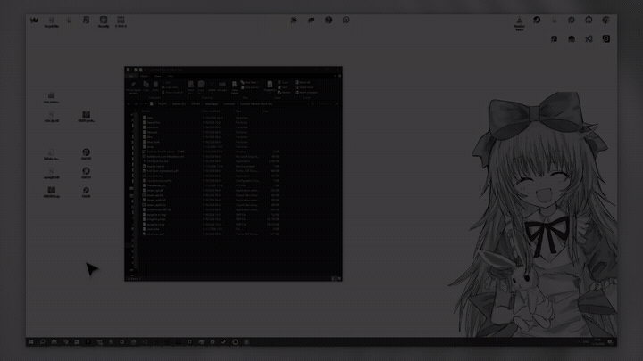
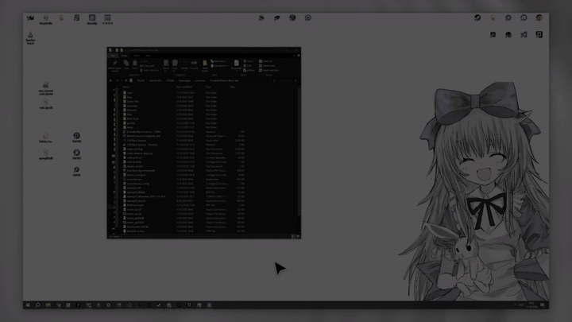
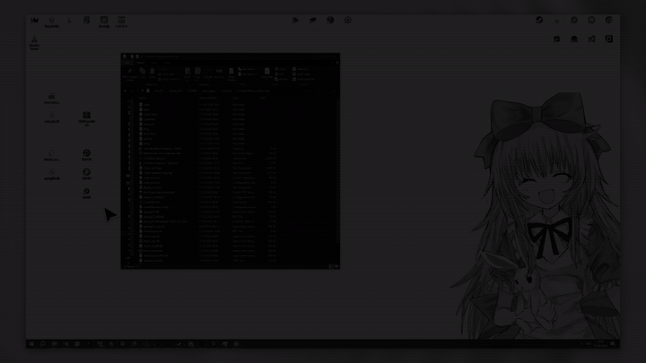

<div align="center">

# Installation
</div>
This guide is for players. It covers three things:

1. [Install the proxy](#1-install-the-proxy)
2. [Install a mod](#2-install-a-mod)
3. [Install a build profile](#3-install-a-build-profile)

---

> [!WARNING]
> Step 1 (the proxy, config and a profile) is REQUIRED. Step 2 is optional.
> Step 3 explains how the profile is found and verified.

## 1. Install the proxy and a profile.



1. Download `opengl32.dll`, `coke_config.ini` and `PROFILES.zip` from the
   latest release.
2. Copy all three files into the game folder, next to `CM Black Sea.exe`. On the
   first launch the proxy creates `profiles\` and extracts every profile folder
   from the zip. No manual extraction is needed:

   ```text
   opengl32.dll
   coke_config.ini
   PROFILES.zip
   profiles\CM Black Sea.exe\steam-32.ini   (created on first launch)
   ```

3. Start the game normally, through Steam or GOG, or directly from the exe if
   this install starts without a launcher. The proxy creates a `coke\` folder
   next to the executable on first launch.
4. The game now opens in a resizable window. Press `F11` to toggle borderless
   fullscreen. You are not done yet.
5. Press `F10` to toggle the FPS counter at runtime, or set `show_fps=0` in
   `coke_config.ini` to start with it hidden.
6. Confirm the profile loaded: open `coke.log` and look for a `profile:` line
   naming your build. If it says `profile: safe mode`, see
   [Install a build profile](#3-install-a-build-profile).

Do not replace the system `opengl32.dll`. The proxy keeps its own copy of the real `opengl32.dll` under
`%LOCALAPPDATA%\coke-temp\`. It never replaces the system DLL, and it never
changes the game executable.

### Where files appear

After the first launch the game folder also contains:

```text
coke.log          log file, useful for bug reports
coke\             mod folder, created on first launch
profiles\         build profiles, extracted from PROFILES.zip
```

`PROFILES.zip` is only read at startup. You can delete it after the first launch,
or leave it in place to reinstall the profiles later.

### Release and profile checks

If you opt in to update checks, Coke checks the latest GitHub release when the
game starts. **Open release** takes you to that version's download page. If
automatic profile discovery found no match, Coke can inspect the release's
`PROFILES.zip` in memory for your exact game build. When the running Coke version
already matches the release, **Download profiles** opens the archive in your
browser. Place it next to the game executable and restart. Existing profile files
are preserved when the game extracts the archive.

### Uninstall

Delete `opengl32.dll`, `coke_config.ini` and `PROFILES.zip`. You can also delete
`coke.log`, `coke\` and `profiles\` if you do not plan to reinstall. The game is
untouched.
### If something goes wrong

1. Set `verbose=1` in `coke_config.ini`.
2. Start the game, reproduce the problem, then close it.
3. Open `coke.log` and check the last lines.
4. Open an issue and attach `coke.log` plus your Windows version and game
   build (Steam or GOG).

Set `profile=none` in `coke_config.ini` to disable engine patches. Window
controls and consented mods are still available. For recovery with native mods
disabled as well, launch the game with the environment variable
`COKE_SAFE_START=1`.

Deployment preserves existing config and profiles by default.
`scripts/deploy.ps1 -GameDir <path> -Preview` shows what would be copied.
Use `-ResetConfig` or `-ReplaceProfiles` to replace the corresponding files.

## 2. Install a mod



A mod is a DLL that the proxy loads into the game. The proxy creates a `coke\`
folder next to `CM Black Sea.exe` after the first launch.

1. Copy the mod DLL into `coke\`:

   ```text
   coke\your_mod.dll
   ```

2. Create a consent file with the same name as the DLL and a `user_consent_`
   prefix. An empty file is enough:

   ```text
   coke\user_consent_your_mod.txt
   ```

3. Start the game. The mod loads at startup.

The proxy only loads top-level `coke\*.dll` files, and only when the matching
consent file exists. It never scans subfolders and never modifies the EXE. Delete
the consent file to stop that mod from loading.

> **Only install mods you trust.** A mod runs with the same privileges as the
> game. The consent file is an acknowledgement, not a sandbox.

### Example: the FPS mod

`coke_fps.dll` is a small example mod. It draws the same FPS counter as the
proxy. Install it like any other mod:

```text
coke\coke_fps.dll
coke\user_consent_coke_fps.txt
```

Extract `coke-mods.zip` into `coke\` to install the bundled mods, including
Coke Shot. Create an empty `user_consent_coke_camera.txt` in `coke\` to enable
Coke Shot.

## 3. Install a build profile



Get a profile from releases or [README.md](../../README.md#profiles).
A profile tells the proxy where the engine keeps its canvas and scene data.
Every title needs one.

1. Download `PROFILES.zip`.
2. Copy it into the game folder, next to the executable.
3. Start the game. The proxy creates `profiles\` and extracts every profile
   folder from the zip. The result looks like this:

   ```text
   CM Cold War.exe
   opengl32.dll
   coke_config.ini
   PROFILES.zip
   profiles\
     CM Black Sea.exe\
       steam-32.ini
     CM Cold War.exe\
       gog-32.ini
     CM Shock Force 2.exe\
       gog-32.ini
   ```

4. Open `coke.log`. The `profile:` line should name the build that matches your
   game. If it says `profile: safe mode`, the build identity does not match.

The installer only reads the zip at startup. Leave `PROFILES.zip` in place to
refresh the profiles on every launch, or delete it after the first launch. An
existing profile with the same path is overwritten by the zip copy.

### Manual profile install

If you prefer to manage the files yourself, extract `PROFILES.zip` and copy the
folder for your game into `profiles\`:

```text
profiles\CM Cold War.exe\gog-32.ini
```

You can also point at a profile directly with `profile=` in `coke_config.ini`;
see [CONFIG.md](../ai/CONFIG.md#profile).

## No profile? Build your own: [PORTING.md](../ai/PORTING.md).

A profile is build-specific. A game patch can change the identity, and then the
old profile is ignored. The proxy then runs in safe mode, so the game still
starts, but live re-layout is not applied.

Profiles are trusted input: they tell the proxy which memory to write. Only use
profiles from this repository or ones you wrote yourself. The full schema and
the safety checks are in [profiles/README.md](../../profiles/README.md).

## Related documents

- [README.md](../../README.md): what the proxy does, current features and profiles.
- [CONFIG.md](../ai/CONFIG.md): every setting in `coke_config.ini`.
- [SECURITY.md](SECURITY.md): what a mod or profile is allowed to do.
- [PROFILING.md](../ai/PROFILING.md): measuring frame time with `coke-prof` and ETW.
